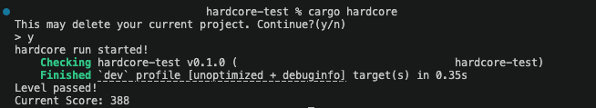
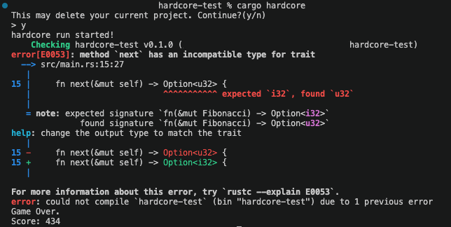

# cargo-hardcore
Welcome to cargo-hardcore! You thought Rust was hard already? Think again! This fun cargo extension takes inspiration from Minecraft's Hardcore mode. In Minecraft when you die in a Hardcore world the world is deleted. With cargo-hardcore, when the compiler throws an error or warning everything in your `src` folder is deleted and reset as if it were a new `bin` app! 

This is meant as a fun game to test your Rust knowledge and should not be used in any serious project. I also doubt it would be useful in teaching someone Rust. Maybe it will encourage the use of docs.rs more but otherwise recommending this as a way to learn Rust feels cruel(if not also counter productive to the benefits of the compiler as an educational tool). Anyway, I've had fun getting humbled by this simple extension and I hope it can add a fun mix-up to your Rust development process as well! 

How complex of a program can you make? 

## Installation

Install with `cargo install cargo-hardcore`

## Usage

```console
$ cargo hardcore
```

Currently, no command line arguments are accepted and you will always be prompted to proceed before the extension runs.

## Scoring

Currently the compilation time is used for scoring. Open to suggestions here!

## Examples
### Successful compilation


### Unsuccessful compilation


## License
- MIT license (see LICENSE or http://opensource.org/licenses/MIT)

## TODO
- [ ] Lib projects? 
- [ ] Better scoring?
